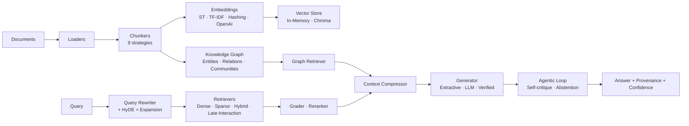

<div align="center">

# 🧠 RAGForge
### *Retrieval-Augmented Generation, Chunking, Evaluation & Knowledge Graphs — in one toolkit*

[](https://python.org)
[](LICENSE)
[](#tests)
[](https://github.com/Pratyush-bit69/Ragandchunk)

**A production-grade, research-flavored RAG framework** that fuses intelligent chunking, hybrid retrieval, knowledge-graph reasoning, agentic self-correction, and rigorous evaluation — all runnable on a laptop CPU.

[Quick Start](#-quick-start) · [Features](#-features) · [Architecture](#-architecture) · [Advanced](#-advanced-capabilities) · [Evaluation](#-evaluation) · [API](#-api--ui)

</div>

---

## ✨ Why RAGForge?

Most RAG demos stop at "embed → retrieve → generate". RAGForge goes further:

- 🧩 **9 chunking strategies** with adaptive, structure-aware splitting
- 🔀 **Hybrid + late-interaction retrieval** (dense · BM25 · RRF · ColBERT-style MaxSim · MMR)
- 🕸️ **Knowledge-Graph RAG** with entity/relation extraction, community detection & GraphRAG
- 🤖 **Agentic RAG** — plan → retrieve → grade → rewrite → synthesize → self-critique → abstain
- 🧪 **LLM-as-a-Judge** evaluation + multi-agent debate + self-consistency
- 📊 **30+ metrics** across retrieval, generation, multi-hop, conflict, provenance & abstention
- 🖥️ **FastAPI + Streamlit** out of the box
- ⚡ Runs on CPU with a local LLM (Qwen2.5-0.5B) — no API key required

---

## 🏗️ Architecture



---

## 🚀 Quick Start

```bash
git clone https://github.com/Pratyush-bit69/Ragandchunk.git
cd Ragandchunk
python3 -m venv .venv && source .venv/bin/activate
pip install -r requirements.txt

# Run everything in one command (~3.5 min on CPU)
python scripts/run_all.py
```

Or run individual demos:

```bash
python scripts/demo.py              # basic RAG + eval + graph
python scripts/advanced_demo.py    # agentic RAG, HyDE, conflict detection
python scripts/llm_rag_demo.py     # RAG with a real LLM (Qwen2.5)
python scripts/llm_judge_demo.py   # LLM-as-judge + reranker + conversational
python scripts/compare_chunking.py  # ablation over chunking strategies
```

---

## 🎯 Features

### 📄 Document Loading
`txt` · `md` · `csv` · `json` · `html` · directories (recursive glob)

### ✂️ Chunking Strategies

| Strategy | Description |
|---|---|
| `fixed` | Fixed character window with overlap |
| `recursive` | LangChain-style recursive splitting |
| `sentence` | Sentence-boundary aware |
| `paragraph` | Paragraph-aware packing |
| `sliding` | Sliding window |
| `token` | Tiktoken-based token chunking |
| `semantic` | Embedding-based breakpoint detection |
| `parent_child` | Small-to-big retrieval |
| `code` | Definition-boundary splitting |
| `adaptive` | Structure + information-density aware |

### 🔍 Retrieval

- **Dense** — cosine similarity over embeddings
- **Sparse** — BM25 (rank-bm25)
- **Hybrid** — RRF-style fusion of dense + sparse
- **Late Interaction** — ColBERT-style MaxSim over token embeddings
- **MMR** — diversity-aware selection
- **Multi-Query** — query variants + dedup
- **Parent-Document** — retrieve small, return big
- **Reranking** — cross-encoder + LLM-based reranker

### 🕸️ Knowledge Graph & GraphRAG

- Rule-based + LLM entity/relation extraction
- Multi-hop traversal, community detection (greedy modularity)
- Temporal knowledge graph with validity intervals
- GraphRAG fusion (vector + graph retrieval)
- Matplotlib visualization

### 🤖 Advanced RAG

| Module | What it does |
|---|---|
| `agentic_rag` | Plan → retrieve → grade → rewrite → synthesize → self-critique → abstain |
| `hyde` | Hypothetical Document Embeddings |
| `query_decomposition` | Multi-hop question splitting |
| `query_rewriter` / `query_expansion` | Recall-boosting variants |
| `retrieval_grader` | LLM/heuristic relevance grading |
| `conflict` | Detect contradictory sources + provenance |
| `confidence` | Calibrated abstention |
| `verified_generation` | NLI-style faithfulness gating |
| `multi_agent_debate` | Dense vs sparse agents + judge |
| `self_consistency` | Sample + vote |
| `graph_of_thoughts` | Thought-graph reasoning |
| `adaptive_retrieval` | Complexity-based top-k |
| `context_compression` | Extractive/LLM compression |
| `conversational_rag` | Multi-turn memory + condensation |
| `llm_reranker` / `llm_judge` | LLM-powered rerank & evaluation |

### 🧪 Evaluation (30+ metrics)

**Retrieval:** Precision@k · Recall@k · Hit Rate · MRR · MAP · nDCG@k

**Generation:** Faithfulness · Answer Relevance · Context Precision/Recall · Token F1 · ROUGE-L · Exact Match

**Complex:** Multi-hop accuracy · Reasoning chain score · Conflict resolution · Abstention quality (P/R/F1) · Provenance score · Citation coverage · LLM-as-judge

---

## 🖥️ API & UI

```bash
# FastAPI
python api.py          # http://localhost:8000
# POST /init  {"data_dir": "data/sample_docs"}
# POST /query {"query": "What is RAG?"}
# POST /agentic {"query": "..."}
# POST /debate  {"query": "..."}

# Streamlit
streamlit run app.py
```

---

## 🧪 Tests

```bash
python -m pytest -q
# 28 passed
```

---

## 📁 Project Layout

```
rag/
├── config.py              # dataclass config + env overrides
├── loaders.py             # txt/md/csv/json/html/directory
├── chunking.py            # 9 chunking strategies
├── embeddings.py          # ST · TF-IDF · hashing · OpenAI · cached
├── vectorstore.py         # in-memory + Chroma + persistence
├── retrievers.py          # dense/sparse/hybrid/rerank/MMR/multi-query/parent
├── graph.py               # knowledge graph + GraphRAG
├── generation.py          # extractive · OpenAI · Anthropic · HuggingFace
├── evaluation.py          # 30+ metrics + BenchmarkRunner
├── pipeline.py            # end-to-end orchestration
└── advanced/              # 15 innovative modules
data/                      # sample docs + eval dataset
scripts/                   # CLI demos & run_all.py
tests/                     # pytest suite
app.py                     # Streamlit UI
api.py                     # FastAPI service
```

---

## ⚙️ Configuration

All components configurable via `rag/config.py` (`RAGConfig`) or env vars:

| Env Var | Default |
|---|---|
| `RAG_EMBEDDING_PROVIDER` | `sentence-transformers` |
| `RAG_EMBEDDING_MODEL` | `all-MiniLM-L6-v2` |
| `RAG_GENERATION_PROVIDER` | `extractive` |
| `RAG_GENERATION_MODEL` | `gpt-4o-mini` |
| `RAG_PERSIST_DIR` | — |

Switch to a local LLM: `RAG_GENERATION_PROVIDER=huggingface RAG_GENERATION_MODEL=Qwen/Qwen2.5-0.5B-Instruct`.

---

## 📜 License

MIT — see [LICENSE](LICENSE).

<div align="center">
<b>Built with ❤️ for researchers & builders pushing RAG beyond the basics.</b>
</div>