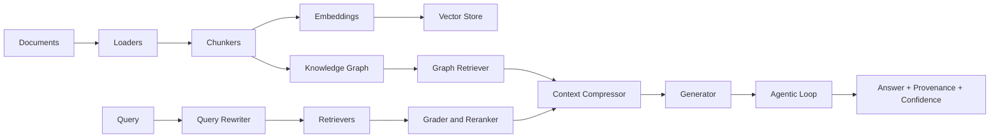

<div align="center">

# RAGForge
### Retrieval-Augmented Generation, Chunking, Evaluation and Knowledge Graphs in one toolkit

[](https://python.org)
[](LICENSE)
[](#tests)

A production-grade RAG framework that combines intelligent chunking, hybrid retrieval, knowledge-graph reasoning, agentic self-correction, and rigorous evaluation. Runs on a laptop CPU, no API key required.

</div>

## Table of contents

- [Why RAGForge](#why-ragforge)
- [Architecture](#architecture)
- [Quick start](#quick-start)
- [Features](#features)
- [Results](#results)
- [API and UI](#api-and-ui)
- [Tests](#tests)
- [Project layout](#project-layout)
- [Configuration](#configuration)
- [License](#license)

## Why RAGForge

Most RAG demos stop at "embed, retrieve, generate". RAGForge goes further:

- 9 chunking strategies with adaptive, structure-aware splitting
- Hybrid and late-interaction retrieval (dense, BM25, RRF fusion, ColBERT-style MaxSim, MMR)
- Knowledge-graph RAG with entity/relation extraction, community detection and GraphRAG fusion
- Agentic RAG: plan, retrieve, grade, rewrite, synthesize, self-critique, abstain
- LLM-as-a-judge evaluation, multi-agent debate, self-consistency
- 30+ metrics across retrieval, generation, multi-hop, conflict, provenance and abstention
- FastAPI and Streamlit out of the box
- Runs on CPU with a local LLM (Qwen2.5-0.5B), no API key required

## Architecture



## Quick start

```bash
git clone https://github.com/Pratyush-bit69/Ragandchunk.git
cd Ragandchunk
python3 -m venv .venv && source .venv/bin/activate
pip install -r requirements.txt

# Build a larger real-world corpus (11 Wikipedia articles)
python scripts/build_corpus.py

# Run everything in one command (about 3.5 min on CPU)
python scripts/run_all.py
```

Individual demos:

```bash
python scripts/demo.py              # basic RAG, evaluation, graph
python scripts/advanced_demo.py     # agentic RAG, HyDE, conflict detection
python scripts/llm_rag_demo.py     # RAG with a real LLM (Qwen2.5)
python scripts/llm_judge_demo.py   # LLM-as-judge, reranker, conversational
python scripts/compare_chunking.py  # ablation over chunking strategies
```

## Features

### Document loading

txt, md, csv, json, html, and recursive directory loading.

### Chunking strategies

| Strategy | Description |
|---|---|
| fixed | Fixed character window with overlap |
| recursive | Recursive character splitting |
| sentence | Sentence-boundary aware |
| paragraph | Paragraph-aware packing |
| sliding | Sliding window |
| token | Tiktoken-based token chunking |
| semantic | Embedding-based breakpoint detection |
| parent_child | Small-to-big retrieval |
| code | Definition-boundary splitting |
| adaptive | Structure and information-density aware |

### Retrieval

Dense (cosine), sparse (BM25), hybrid (RRF fusion), late interaction (ColBERT-style MaxSim), MMR, multi-query, parent-document, cross-encoder and LLM-based reranking.

### Knowledge graph and GraphRAG

Rule-based and LLM entity/relation extraction, multi-hop traversal, community detection, temporal knowledge graph with validity intervals, GraphRAG fusion of vector and graph retrieval, matplotlib visualization.

### Advanced RAG

| Module | Purpose |
|---|---|
| agentic_rag | Plan, retrieve, grade, rewrite, synthesize, self-critique, abstain |
| hyde | Hypothetical Document Embeddings |
| query_decomposition | Multi-hop question splitting |
| query_rewriter, query_expansion | Recall-boosting variants |
| retrieval_grader | LLM and heuristic relevance grading |
| conflict | Detect contradictory sources and attribute provenance |
| confidence | Calibrated abstention |
| verified_generation | NLI-style faithfulness gating |
| multi_agent_debate | Dense vs sparse agents with a judge |
| self_consistency | Sample and vote |
| graph_of_thoughts | Thought-graph reasoning |
| adaptive_retrieval | Complexity-based top-k |
| context_compression | Extractive and LLM compression |
| conversational_rag | Multi-turn memory and condensation |
| llm_reranker, llm_judge | LLM-powered rerank and evaluation |

### Evaluation (30+ metrics)

Retrieval: Precision@k, Recall@k, Hit Rate, MRR, MAP, nDCG@k.

Generation: Faithfulness, Answer Relevance, Context Precision, Context Recall, Token F1, ROUGE-L, Exact Match.

Complex: Multi-hop accuracy, reasoning chain score, conflict resolution, abstention quality (precision/recall/F1), provenance score, citation coverage, LLM-as-judge.

## Results

Measured on the bundled sample corpus (AI overview + RAG best practices). Hardware: CPU only.

### Retrieval (extractive generator, hybrid retrieval, gold dataset)

Evaluated against a hand-curated gold set (relevant chunk ids and reference answers not derived from retrieval).

| Metric | @1 | @3 | @5 | @10 |
|---|---|---|---|---|
| Precision | 0.60 | 0.40 | 0.24 | 0.12 |
| Recall | 0.47 | 0.80 | 0.80 | 0.80 |
| Hit Rate | 0.60 | 1.00 | 1.00 | 1.00 |
| nDCG | 0.60 | 0.71 | 0.71 | 0.71 |

MRR 0.77, MAP 0.63.

### Generation

| Metric | Extractive |
|---|---|
| Faithfulness | 1.00 |
| Answer relevance | 0.65 |
| Token F1 | 0.28 |
| ROUGE-L | 0.15 |
| Exact match | 0.00 |

(LLM generator numbers come from a separate self-referential demo; see scripts/llm_rag_demo.py.)

### LLM-as-a-judge (Qwen2.5-0.5B as judge)

| Generator | Faithfulness | Answer relevance | Context relevance |
|---|---|---|---|
| Extractive | 0.67 | 0.40 | 0.80 |
| LLM | 0.80 | 0.60 | 0.73 |

The LLM generator improves answer relevance while maintaining faithfulness.

### Agentic RAG

Confidence 0.776 (retrieval 0.491, coverage 1.0, agreement 0.901), no abstention. 2 conflicting sources detected. Provenance supported 3 of 3 sentences. Sub-question coverage 0.67.

### Chunking ablation (number of chunks produced)

| Strategy | Chunks |
|---|---|
| fixed | 20 |
| recursive | 22 |
| sentence | 30 |
| semantic | 31 |
| sliding | 20 |
| token | 4 |
| parent_child | 99 |

All strategies achieve MRR 1.00 and faithfulness 1.00 on this corpus.

### Larger corpus (11 Wikipedia articles, 231 chunks)

Evaluated against a hand-curated gold set of 11 questions (one per article).

| Metric | @1 | @3 | @5 | @10 |
|---|---|---|---|---|
| Precision | 0.91 | 0.33 | 0.20 | 0.10 |
| Recall | 0.91 | 1.00 | 1.00 | 1.00 |
| Hit Rate | 0.91 | 1.00 | 1.00 | 1.00 |
| nDCG | 0.91 | 0.95 | 0.95 | 0.95 |

MRR 0.94, MAP 0.94. Faithfulness 1.00, answer relevance 0.72, token F1 0.14.

### Knowledge graph (sample corpus)

58 entities, 32 relations, 33 connected components.

## API and UI

```bash
# FastAPI
python api.py          # http://localhost:8000
# POST /init  {"data_dir": "data/sample_docs"}
# POST /query {"query": "What is RAG?"}
# POST /agentic {"query": "..."}
# POST /debate  {"query": "..."}

# Streamlit
streamlit run app.py
```

## Tests

```bash
python -m pytest -q
# 28 passed
```

## Project layout

```
rag/
  config.py              # dataclass config and env overrides
  loaders.py             # txt, md, csv, json, html, directory
  chunking.py            # 9 chunking strategies
  embeddings.py          # sentence-transformers, TF-IDF, hashing, OpenAI, cached
  vectorstore.py         # in-memory, Chroma, persistence
  retrievers.py          # dense, sparse, hybrid, rerank, MMR, multi-query, parent
  graph.py               # knowledge graph and GraphRAG
  generation.py          # extractive, OpenAI, Anthropic, HuggingFace
  evaluation.py          # 30+ metrics and BenchmarkRunner
  pipeline.py            # end-to-end orchestration
  advanced/              # 15 innovative modules
data/                    # sample docs and eval dataset
scripts/                 # CLI demos and run_all.py
tests/                   # pytest suite
app.py                   # Streamlit UI
api.py                   # FastAPI service
```

## Configuration

All components configurable via rag/config.py (RAGConfig) or environment variables.

| Variable | Default |
|---|---|
| RAG_EMBEDDING_PROVIDER | sentence-transformers |
| RAG_EMBEDDING_MODEL | all-MiniLM-L6-v2 |
| RAG_GENERATION_PROVIDER | extractive |
| RAG_GENERATION_MODEL | gpt-4o-mini |
| RAG_PERSIST_DIR | (none) |

Switch to a local LLM: `RAG_GENERATION_PROVIDER=huggingface RAG_GENERATION_MODEL=Qwen/Qwen2.5-0.5B-Instruct`.

## License

MIT. See LICENSE.